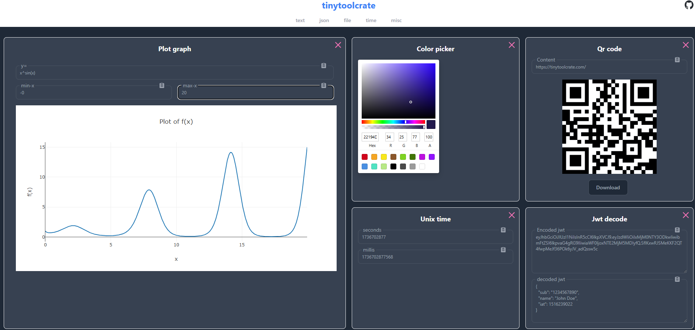

# tinytoolcrate
A collection of tiny developer productivity tools

75 utilities across text, json, file, time, code, net, crypto, and misc. Everything runs locally in the browser, works offline as a PWA, and persists your open panels in the url.

## Run locally
```
git clone https://github.com/Timmoth/tinytoolcrate.git
cd tinytoolcrate/webapp
yarn
yarn dev
```

## Tests
End to end tests run with Playwright (Chromium):
```
yarn test:e2e          # headless
yarn test:e2e:headed   # headed
yarn test:e2e:report   # html report
```

<p align="center">
   <div style="width:640;height:320">
       
</div>
</p>